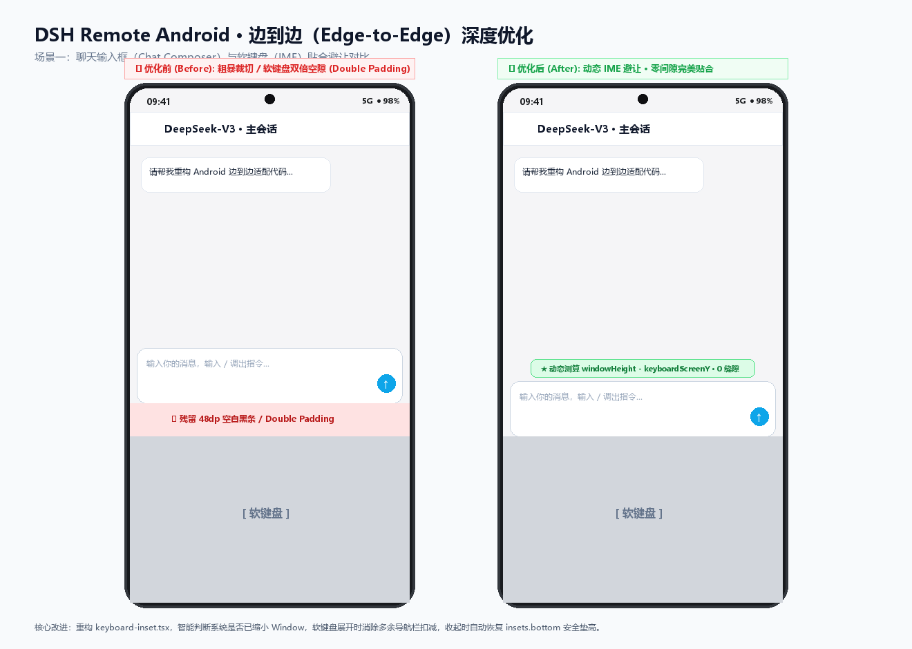
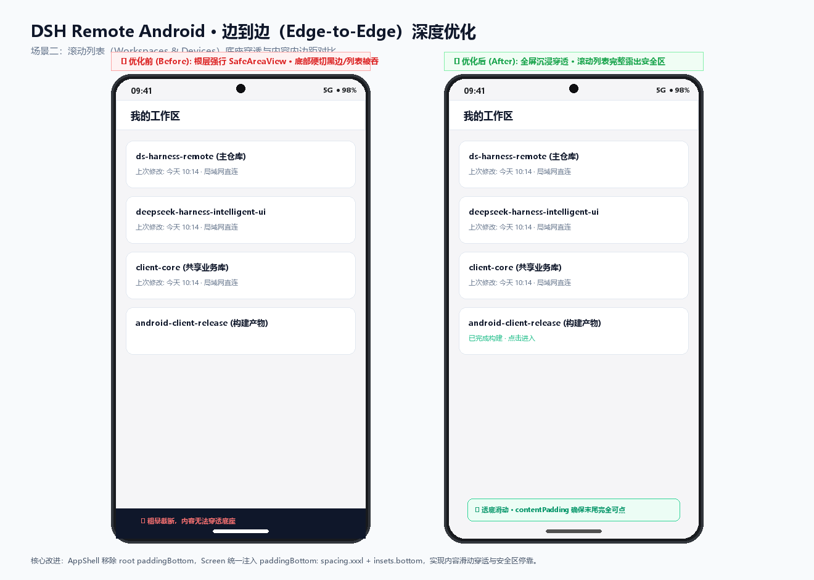
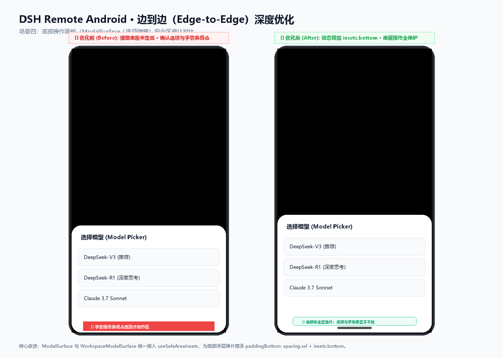

# Android 14/15+ Edge-to-Edge 沉浸式与键盘/手势避让优化对比

本文档记录针对当前仓库 `apps/android` 客户端在 Android 14/15+ 强制 Edge-to-Edge 环境下的沉浸式系统栏、底部手势条、软键盘（IME）贴合以及各全屏/半屏弹窗安全避让的优化对比。

---

## 1. 聊天输入框与软键盘联动（Chat Composer & IME Insets）

**优化前问题**：
- 在 Android 15 强制 Edge-to-Edge 且未缩放窗口，或系统 `adjustResize` 生效时，固定使用 `keyboardHeight + insets.bottom` 会导致底部手势栏与键盘高度叠加，出现明显的**双倍垫高黑缝（Double Padding）**；
- 键盘收起与弹出动画期间手势栏闪烁或无法无缝贴底。

**优化方案**：
- 重构 `KeyboardInset`：通过监听 `keyboardDidShow` / `keyboardDidHide` 获取真实 `endCoordinates.screenY`，并利用 `Math.max(0, windowHeight - keyboardScreenY)` 精确测算视口被键盘遮挡的像素量；
- 软键盘升起时纯净贴合键盘顶部；软键盘收回时平滑退回到 `insets.bottom` 手势条安全间距；
- 增加 `AppState` 监听，切后台或丢弃 hide 事件时自动回落安全区。

---

## 2. 列表内容穿透与底部触底避让（Content Padding Penetration）

**优化前问题**：
- 根级 `App.tsx` 粗暴在 `<SafeAreaView edges={['left', 'right', 'bottom']}>` 截断底部，导致全屏背景在手势条处产生突兀的白底/黑底断层；
- 消息流 `FlatList`、工作区列表滑到最底端时被系统手势横条遮挡，最后一行按钮或文字无法完全露出发起点击。

**优化方案**：
- 根布局改用 `edges={['left', 'right']}`，释放顶部状态栏与底部导航栏；
- 在 `Screen` 滚动容器与各列表 `contentContainerStyle` 中注入自适应动态 `paddingBottom: basePadding + insets.bottom`；
- 滑动过程中内容在透明/半透明手势栏下方优雅穿透，滑至底部时末尾元素完全位于手势栏上方安全操作区内。

---

## 3. 终端与全屏视图适配（Terminal Session Tools Modal）

**优化前问题**：
- Session Tools（只读终端、文件预览）全屏 `<Modal>` 未声明 `statusBarTranslucent`，弹出时导致状态栏强制填充纯色黑条；
- 外层硬编码 `paddingTop` 与 `paddingBottom`，造成顶部标题栏下陷或底部命令输入提示符、快捷按钮被手势指示条遮盖截断。

**优化方案**：
- 全屏 Modal 启用 `statusBarTranslucent`，消除状态栏黑边跳变；
- 外层移除硬编码 padding，交给 `TopBar` 结合 `insets.top` 优雅顶入状态栏安全线；
- 底部通过 `KeyboardInset` 与 `insets.bottom` 自适应垫高，无论键盘是否升起，终端最后一行命令行均清晰可见、绝不被遮挡。

---

## 4. 半屏底弹窗与表单适配（Bottom Sheet Modals Insets）

**优化前问题**：
- 权限审批面板、工作区创建、设备重命名等 Bottom Sheet 模态框底部未贴合安全内边距，操作按钮（如“确认授权”、“重命名”、“取消”）过于贴近底部边缘甚至被横条截断；
- 弹出时背景遮罩未穿透状态栏。

**优化方案**：
- 统一为所有浮层与 Modal 声明 `statusBarTranslucent`；
- 在 `ModalSurface`、`WorkspaceModalSurface` 底部注入 `paddingBottom: basePadding + insets.bottom`，提供符合 Material 3 边到边规范的视觉呼吸空间。

---

## 5. Pull Request 提交记录 (PR #128)

- **PR 链接**: [GitHub PR #128](https://github.com/liguobao/ds-harness-remote/pull/128)
- **目标分支**: `liguobao/ds-harness-remote:main` <- `dreamfarer-space/ds-harness-remote:feat/android-edge-to-edge`

